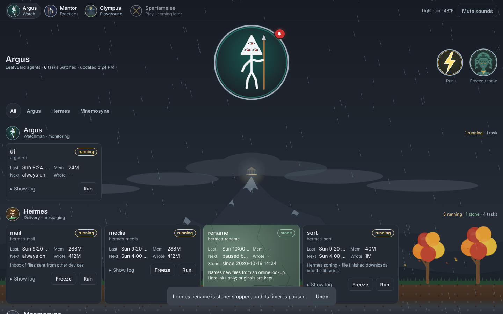
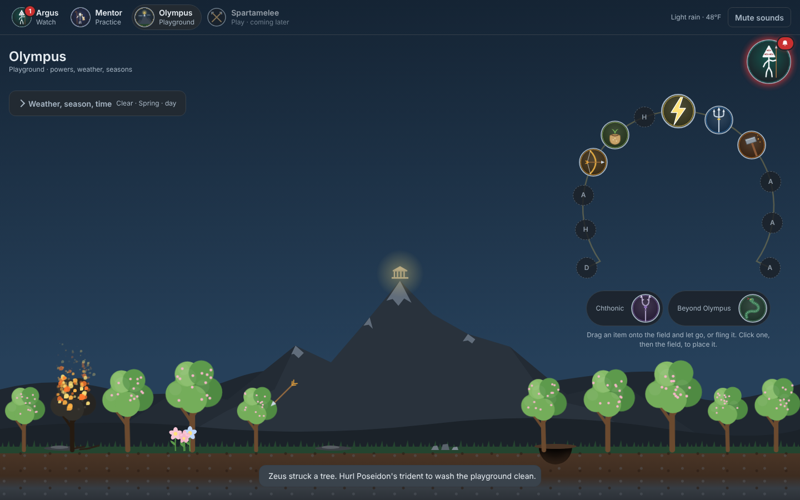
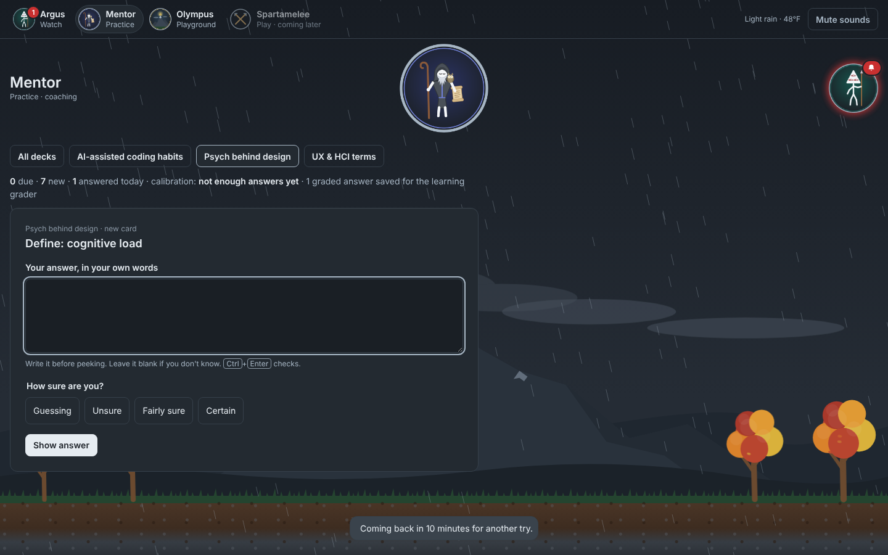

# Argus UI

A small, self-hosted web page that watches the background jobs on a Linux machine (systemd `--user` services and timers) and lets you act on them from any device on your Tailscale network. It's one Python file with no dependencies, plus a static page, and it comes with a hand-drawn Greek-myth theme.



## What it does

**Watch.** Jobs are shown as **tasks**, grouped under **agents** (personas you define). Each card shows whether the task is OK, running, failed or frozen, when it last ran and next runs, its memory use and its latest log. Argus, the many-eyed watchman, follows your pointer. When a task fails, his eyes turn red, a red aura pulses, an alarm badge counts the failures and a short chime plays (unless muted).

**Powers.** Drag a medallion onto a task card:
- **Zeus's bolt** runs the task now, or restarts an always-on service.
- **Medusa's gaze** *freezes* a task: it stops it and pauses its timer, and the card turns to stone. Use her again to *thaw* it, which restores exactly what was enabled or running. Nothing is ever deleted.

**Scene.** Every page sits on Mount Olympus. The grass and trees follow the season, and the sky follows the live weather (rain, snow, fog, storms). The server fetches the weather from Open-Meteo, which needs no API key.

**Olympus · Playground.** The twelve Olympians sit on an Ω, each with an item you can drag, drop or fling onto the scene:
- Zeus's bolt burns trees.
- Medusa's snake turns things to stone.
- Poseidon's trident sends a tsunami that resets everything.
- Hades' bident raises rattling skeletons.
- Demeter's seeds grow seasonal flowers.
- Apollo's bow fires arrows that stick.
- Hephaestus' hammer digs holes.

See [docs/scene.md](docs/scene.md).



**Mentor · Practice.** A spaced-repetition coach. You type each answer, it grades the key ideas, and it tracks how well your confidence matches your results. See [docs/mentor.md](docs/mentor.md).



## How it runs
There's no Docker and no container. Argus is a single Python file (standard library only) that runs as a **systemd user service** on the machine it watches. It reads task status straight from systemd (`systemctl --user`, `journalctl`). It listens only on `127.0.0.1`, and `tailscale serve` publishes it to your own devices over HTTPS. The page is plain HTML, CSS and JavaScript with no build framework.

> Status: personal project, actively changing. It runs the author's home server. The code is MIT-licensed; the Leafy Realm artwork is not (see License). Sound effects are not included.

## What you need
- Linux with systemd and Python 3 (no extra packages).
- Optional: [Tailscale](https://tailscale.com) to reach the page from your other devices over HTTPS.

## Install
```bash
bash scripts/build.sh leafy-realm            # -> dist/argus-ui-<version>-leafy-realm.tar.gz
# copy the package to the machine to watch, then on that machine:
mkdir -p ~/argus-ui && tar -xzf argus-ui-*.tar.gz -C ~/argus-ui && bash ~/argus-ui/install.sh
```
Argus listens on this machine only (`127.0.0.1:8095`) by default. Publish it to your devices over HTTPS on your tailnet at `https://<host>.<tailnet>.ts.net/argus` (Tailscale provides the certificate):
```bash
sudo tailscale serve --bg --set-path /argus http://127.0.0.1:8095
```
On a phone, open that address and use **Add to Home screen** to install it as an app.

## Which jobs show up
Any `systemd --user` service whose name starts with an agent key from the theme, followed by a dash. With the Leafy Realm theme, `hermes-sort` appears under Hermes and `mnemosyne-backup` under Mnemosyne. A JSON file per task in the registry folder (`~/.config/argus-ui/agents/<task>.json`, or the theme's `registry`) can add `notes` shown on the card.

## Themes
A theme is a folder in `themes/` with `theme.json` (title, subtitle, agents, which tasks may never be frozen, sections still to come), an icon per agent and the god artwork. Sound effects are optional and not included. Put your own files in `~/.config/argus-ui/sfx/` on the machine that runs Argus; [themes/leafy-realm/sfx/README.md](themes/leafy-realm/sfx/README.md) lists the file names. Without them, the page plays simple built-in sounds. See [docs/themes.md](docs/themes.md).

## Repository layout
```
server/                 argus_ui.py (HTTP server), mentor.py (practice), sky.py (weather); standard library only
web/                    index.html, css/, js/ (core, scene, powers, olympus, mentor, main), manifest, service worker
themes/leafy-realm/     the author's theme: agents, icons, god artwork, practice decks
scripts/build.sh        builds an installable package for a theme
scripts/install.sh      installs/updates on the target machine (keeps the old version)
scripts/deploy.sh       on the target machine: git pull + build + install
tests/                  bash tests/run.sh: fake systemd units + browser checks (Playwright)
docs/                   scene and layer order, Mentor, themes, UX audit, screenshots
```

## Develop and test
`bash tests/run.sh` builds the package, runs it against fake systemd units and checks every page in a real browser (Chromium through Playwright), including a 375px phone and an ultrawide screen. The screenshots above come from that run. On the machine that runs Argus, `bash scripts/deploy.sh` pulls the latest code, builds it and installs it, keeping your sounds, weather location and settings.

## Safety
There is no login, so the server protects itself in other ways:
- **Your network only.** Serve it on your LAN or tailnet (`tailscale serve`, never `funnel`). By default it accepts only this machine, so other devices reach it through `tailscale serve` over HTTPS. To use plain http on a LAN instead, install with `BIND=0.0.0.0`.
- **No cross-site actions.** Actions must be JSON from the page itself (checked with `Sec-Fetch-Site` / `Origin`), so another website you visit can't freeze or run your tasks.
- **No DNS rebinding.** It only answers to this machine's hostname, IP addresses, `*.ts.net` and `*.local` names, plus any in `ARGUS_ALLOWED_HOSTS` (comma separated).
- **Can't delete anything.** Freeze only stops and disables; thaw re-enables exactly what was on. `argus-ui` itself can't be frozen. A task that's running asks for confirmation before it's interrupted.
- Static files can't escape the `static/` folder, request bodies are capped, and text from unit descriptions can't break out of the page's script.

## License
Code: MIT (see LICENSE). The Leafy Realm theme's artwork is **not** covered by the MIT license. See `themes/leafy-realm/ASSETS.md`.
